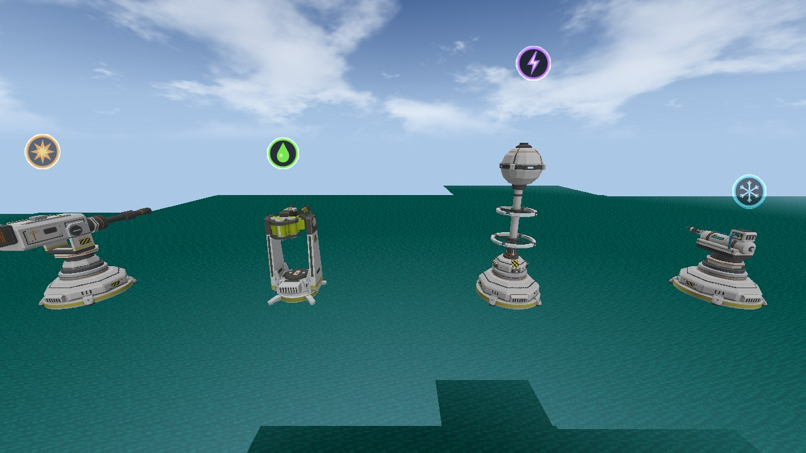
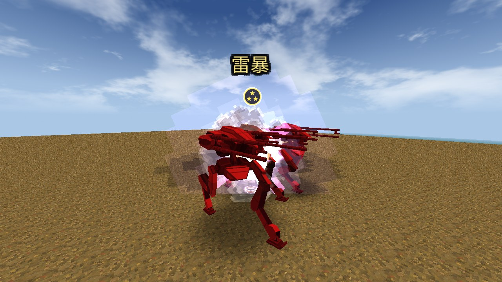
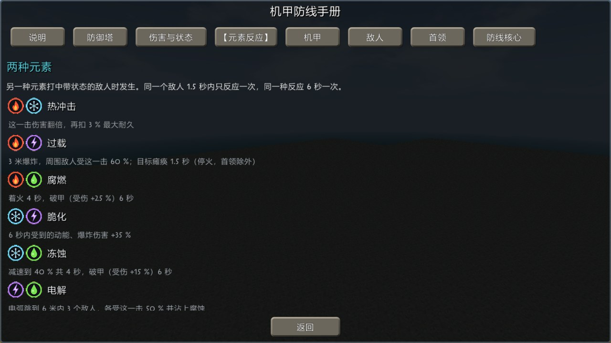
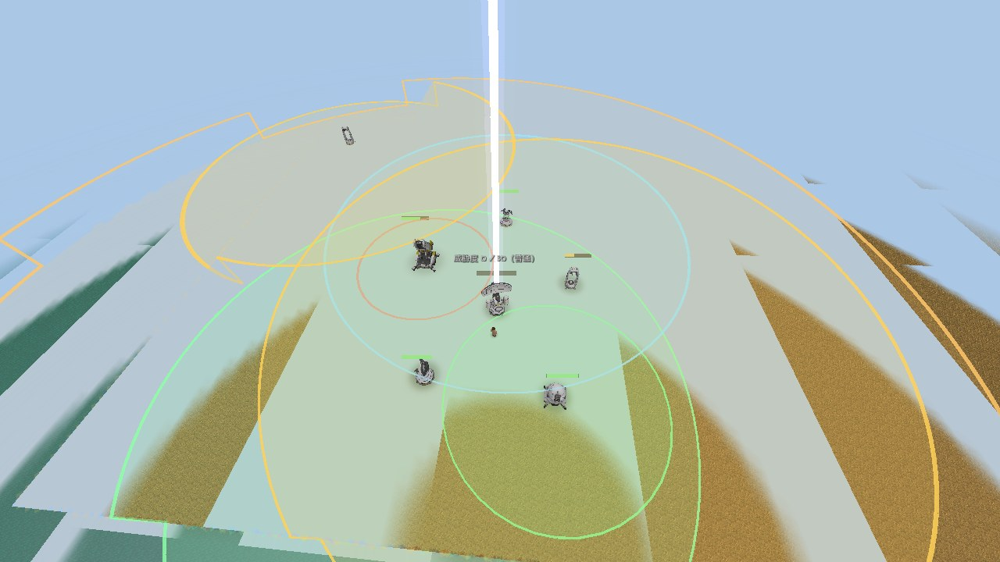

# 机甲防线（Survivalcraft Mech Defense）

《生存战争》（Survivalcraft）插件版的塔防模组，当前版本 1.0.0，面向 API 1.9.3.1（1.9.4、1.9.5.1 也逐项测过），.NET 10。包名 `zh667.MechDefense`。

一句话：在生存世界里造防御塔守阵地，敌方机兵夜里来袭，你可以亲自上阵或者开机甲，最后和首领机甲对打。

- 46 种防御塔加一座防线核心：19 种特色塔，和转轮机枪塔、冰冻塔、火焰塔、导弹塔、加农炮、防空炮、雷达、磁暴线圈、电磁脉冲 9 种塔各三阶。
- 7 种敌方机兵（步行机兵、导弹机兵、炮击机兵、装甲战车、两种无人机、维修无人机）和 5 种首领。
- 3 台可驾驶机甲：水星 → 复仇女神 → 轩辕十四，逐台升级。
- 游戏里有一本《机甲防线手册》（木板 + 煤块合成，每个存档第一次进入时送一本），本页的规则在手册、“帮助”和“生物图鉴”里都能查到，文字由游戏里的实际数据生成。



## 怎么玩

1. **造塔**。一阶塔只用原版材料，在工作台合成，放在地上就开始自动索敌。手持部署物时会显示占地和攻击范围圈；放下后空手右键炮塔可以拿起来挪位置，拆塔用镐敲。
2. **敌人来袭**。从“开始天数”（默认第 3 天）起，机兵夜里在野外出没，也会成队夜袭你的阵地。击毁它们掉落机兵残骸、火控芯片、能量核心，用来造二阶、三阶塔和修塔。
3. **机甲**。首领掉落机甲设计图，用它合成第一台机甲“水星”（要求玩家等级 8）。机甲是玩家亲自上场的手段：能换弹药元素、打首领的弱点、在首领破甲时集中输出。
4. **首领**。用诱敌信标主动引来，或者累计击毁 80 台机兵后自己来（数量可在设置里改）。5 种首领随机来一种，各有预警招式和专门的打法。
5. **防线核心**（可选玩法）。放下核心后，附近每击毁一台机兵涨威胁度，满了引来多波次袭击，可以开无尽模式。核心自带 16 格储存（右键打开），会把附近的掉落物收进去；核心 30 米内的炮塔组成防御罩：罩内炮塔受到的任何伤害都由罩子先扛，罩内的机甲和玩家则替它们挡机兵的攻击。

所有刷新、夜袭、难度、成长的参数都在“模组设置 → 机甲防线 → 全部设置”里调。

## 机制与数值设计

下面每一块都写三件事：规则是什么、关键数字、为什么这样定。数字以仓库里的代码和配置为准，括号里是出处。更细的过程记录在 [docs/COMBAT_DESIGN.md](docs/COMBAT_DESIGN.md)、[docs/PROGRESSION.md](docs/PROGRESSION.md) 和 [docs/STATUS.md](docs/STATUS.md)。

总的方向（[docs/COMBAT_DESIGN.md](docs/COMBAT_DESIGN.md) 第 0 节）：主线是敌人和玩家之间的对抗。炮塔解决“量”，玩家解决“题”——每种敌人给玩家出一道题，玩家有炮塔没有的解法（打弱点、绕背、打断蓄力、破甲时开机甲爆发）。

### 1. 六种伤害，每座塔一种

每座塔只有一种伤害类型（`tools/towers.json` 的 `attack.element`）。玩家走到 14 米内，塔头顶会显示它的类型图标。

| 伤害 | 颜色 | 防御塔 | 命中后 |
|---|---|---|---|
| 动能 | 灰白 | 铳械塔、扩装铳械塔、“暴雨”铳械塔、哨戒塔、激流塔、转轮机枪塔 Ⅰ–Ⅲ、防空炮 Ⅰ–Ⅲ | 不留状态 |
| 爆炸 | 橙 | 榴弹塔、高爆榴弹塔、序章炮塔、重锤迫击炮、导弹塔 Ⅰ–Ⅲ、加农炮 Ⅰ–Ⅲ | 不留状态 |
| 热 | 红 | 火焰塔 Ⅰ–Ⅲ、AF1“熔甲者” | 留下“灼烧” |
| 冷 | 青 | 液氮塔、冰冻塔 Ⅰ–Ⅲ | 留下“冰寒” |
| 电 | 紫 | 射线塔、高能射线塔、电涌塔、甲二型“电荷”、全向声波塔、磁暴线圈 Ⅰ–Ⅲ、电磁脉冲 Ⅰ–Ⅲ | 留下“带电” |
| 腐蚀 | 绿 | “酸洗”MK-Ⅰ、“毒沼”MK-Ⅰ | 留下“腐蚀” |

医疗塔、雷达 Ⅰ–Ⅲ 和防线核心不造成伤害，没有类型。机甲的步枪和近战是动能，导弹、火炮、榴弹是爆炸，激光固定是电；机甲还能换“弹药元素”（默认按 X）：水星有标准、热、冷三种，复仇女神多一种电，轩辕十四再多一种腐蚀。其他模组的武器一律按动能算。

为什么这样定：加入伤害类型之前，类型只对一个首领有意义，普通敌人对什么武器都一样（[docs/COMBAT_DESIGN.md](docs/COMBAT_DESIGN.md) 第 1.2 节）。每座塔固定一种、头顶有图标，是为了让玩家一眼看明白——设计时的要求原话是“要有每种伤害的图标，敌人受到攻击、现在处于什么状态要有图标，发生反应要有特效，这样玩家才能看明白”。

### 2. 元素状态和 12 种反应

**状态**：热、冷、电、腐蚀命中后，敌人身上挂 6 秒对应的状态，再命中就刷新时间。状态只是一个计时，没有“攒满才生效”的槽。敌人头顶的图标 32 米内可见。

**反应**：敌人身上已有一种状态时，被另一种元素打中就发生反应。两两组合 8 种（`Mod/MDElements.cs`）：

| 反应 | 组合 | 效果 |
|---|---|---|
| 热冲击 | 热 + 冷 | 这一击 ×2，再扣目标最大耐久的 3 %（对首领这一项减半） |
| 过载 | 热 + 电 | 3 米内其他敌人各受这一击的 60 %；目标瘫痪 1.5 秒，期间不能开火（首领除外） |
| 腐燃 | 热 + 腐蚀 | 着火 4 秒；破甲 6 秒（受到的伤害 ×1.25） |
| 脆化 | 冷 + 电 | 6 秒内受到的动能、爆炸伤害 ×1.35 |
| 冻蚀 | 冷 + 腐蚀 | 减速到 40 %，持续 4 秒；破甲 6 秒（受到的伤害 ×1.15） |
| 电解 | 电 + 腐蚀 | 电弧跳到 6 米内最多 3 个敌人，各受这一击的 50 %，并挂上腐蚀 |
| 扩散 | 爆炸 + 任一状态 | 把目标身上的状态传给 4 米内的敌人，不额外加伤害，也不消耗状态 |
| 碎冰 | 动能 + 冰寒或冻结 | 这一击 ×1.6，冰消掉 |

除了扩散和碎冰，反应会把参与的两种状态都用掉，打来的这一击也不再留下自己的状态。

**三元素反应** 4 种：两种元素刚反应过的 4 秒内（或者敌人身上同时挂着两种状态时），用第三种元素打中触发，三种状态全部用掉，名字是金色大字。

| 反应 | 组合 | 效果 |
|---|---|---|
| 雷暴 | 热 + 冷 + 电 | 这一击 ×3；5 米内的敌人各受一次原伤害；目标瘫痪 2 秒（首领除外） |
| 熔解 | 热 + 冷 + 腐蚀 | 这一击 ×3.5；破甲 8 秒（受到的伤害 ×1.5） |
| 等离子蚀 | 热 + 电 + 腐蚀 | 这一击 ×3；电弧打 8 米内最多 5 个敌人，各受 80 % 并着火；目标着火 5 秒 |
| 晶化 | 冷 + 电 + 腐蚀 | 这一击 ×3；冻结 2.5 秒（首领不冻结，改为这一击再 ×1.5） |

**冷却和不连锁**：

| 规则 | 数字 |
|---|---|
| 同一个敌人，任何反应之后 | 1.5 秒内不再反应 |
| 同一个敌人，同一种两元素反应 | 6 秒一次 |
| 同一个敌人，同一种三元素反应 | 10 秒一次 |
| 反应带出来的溅射、电弧伤害 | 不带元素，不会再引发新的反应 |

为什么这样定：

- 最初的提案只有 3 种反应，用户觉得太少，要“多种元素可以互相组合，而且发生反应要有冷却”，于是做成两两 8 种；三元素反应是随后追加的，要求是“伤害倍率要提高”，所以倍率（×3～×3.5）明显高于两元素（[docs/tasks/2026-10-30-combat-0.15.md](docs/tasks/2026-10-30-combat-0.15.md)）。
- 电磁脉冲 Ⅰ–Ⅲ 和全向声波塔是“只上状态”的塔：命中只留下“带电”，自己不触发反应。原因是它们没有伤害，一旦由它们触发反应，会白白用掉敌人身上的灼烧，还占住 1.5 秒的反应冷却；改成只上状态后，反应留给有伤害的塔去触发（0.18.2）。
- 手机发热是早期玩家反馈过的问题，所以反应不新增粒子系统，只用已有的光圈、闪光和少量火花，数量跟“特效数量”设置走；伤害数字同屏最多 14 / 8 / 4 个，反应名同屏最多 6 / 4 / 2 个（完整 / 精简 / 极简）。
- 模组设置里可以整个关掉元素反应，关掉后伤害类型、抗性、状态都还在。





### 3. 敌人抗性

每种敌人对六种伤害各有一个倍率，表里没写的都是 ×1（`Mod/MDElements.cs` 的 `resist`）。范围定在 ×0.75～×1.5，游戏里的生物图鉴逐条写明。

| 敌人 | 怕 | 抗 |
|---|---|---|
| 双管步行机兵 | 爆炸 ×1.25 | — |
| 导弹步行机兵（精英） | 电 ×1.25 | 动能 ×0.85 |
| 炮击步行机兵（精英） | 热 ×1.25 | 冷 ×0.85 |
| 双管装甲战车 | 爆炸 ×1.25、腐蚀 ×1.25 | 动能 ×0.75；另外正面受伤 ×0.75、背面 ×1.4 |
| 旋翼机炮无人机、维修无人机 | 电 ×1.5、冷 ×1.25 | — |
| 双旋翼无人机（精英） | 电 ×1.25 | 动能 ×0.85 |
| 首领：鸟形重装机甲 | 电 ×1.15 | 爆炸 ×0.85 |
| 首领：双光剑飞行机甲 | 冷 ×1.15 | 动能 ×0.85 |
| 首领：重装悬浮炮艇 | 电 ×1.25 | 爆炸 ×0.85 |
| 首领：重型装甲炮车 | 腐蚀 ×1.25 | 动能 ×0.75 |

首领“恶魔机甲”不走这张表：它有一个每 20 秒轮换的弱点（冲击 / 爆炸 / 能量三类，看脚下光环颜色），只有当前弱点吃全额伤害，另外两类只吃 40 %。

为什么这样定：改之前普通敌人对各种伤害没有任何差别。有了抗性表，战车这类敌人就要换爆炸、腐蚀塔来打——实测铳械塔打战车正面的每秒伤害从 65 降到 36。战车正面硬、背面软，是留给玩家的解法：绕到侧后去打。

### 4. 首领：装甲阶段、失衡、控制递减

**耐久随防线变强**（`Mod/MDBoss.cs`）：首领到达时按附近 48 米内的防线现算，基础 36000，每座塔按阶数加 3600 / 7200 / 10800，附近有机甲再加，最多 360000，再乘每种首领自己的系数。原因是玩家一般会放很多炮塔，首领要跟着防线变强。

**装甲阶段**（代替“每次限伤”）：

| 项目 | 数字 |
|---|---|
| 装甲层数 | 2 层，每层能吸收耐久的 10 % |
| 装甲还在时 | 每次伤害只有 20 % 打进本体 |
| 打破一层 | 首领硬直 3 秒，随后 10 秒内受到的伤害 ×1.5 |
| 单次伤害上限 | 耐久的 8 %（防其他模组的一击必杀武器） |

为什么从“每次限伤 2 %”改成装甲阶段：0.12.0 的做法是每次受伤最多扣总耐久的 2 %，任何武器都至少要打 50 下，单发再重也一样，重武器和机甲体现不出价值。改成装甲阶段后，平时只有 20 % 打进去，打破装甲后的 10 秒才是输出窗口，留着重炮和机甲在这个窗口里打才划算。实测四座二阶塔打首领 45 秒，破甲窗口里打进的伤害占本体伤害的 67～87 %（[docs/COMBAT_DESIGN.md](docs/COMBAT_DESIGN.md) 第 2.3 节）。

**医疗塔的限制**：被首领打中的塔 8 秒内不能被治疗；几座医疗塔不会同时治同一座塔。原因是实测里“十座二、三阶塔 + 三座医疗塔”能在 44～97 秒内无损打死五个首领里的四个；改后同样的阵地 120 秒只打死一个，其余还剩 19～89 % 耐久（[docs/COMBAT_DESIGN.md](docs/COMBAT_DESIGN.md) 第 2.4 节）。

**失衡**：首领不吃瘫痪和冻结，这些控制和元素反应改为往它头顶黄色的“失衡槽”里加值。

| 项目 | 数字 |
|---|---|
| 两元素反应 / 三元素反应 | +12 / +30 |
| 被免疫掉的控制命中 | +6 |
| 重炮命中 / 机甲火炮命中 | +2 / +5 |
| 炮塔造成的失衡 | 每秒最多 4 点；机甲造成的按全额算 |
| 满值 | 100，每失衡一次，下次需要的值 ×1.5 |
| 失衡时 | 硬直 4 秒，随后 8 秒内受到的伤害 ×1.5 并且无视装甲层 |
| 失衡之后 | 锁 30 秒不能再加；2 秒没有新增后每秒掉 8 点 |
| 反应对首领的额外伤害 | 只算 70 % |

为什么这样定：加了元素反应以后首领变好打了，用户的选择是“可以让首领失衡，但反应也不能降到特别低的伤害，失衡也要有进度条，玩家可直观查看”，所以反应伤害只降到 70 %，槽画在首领头顶。第一版试玩后的反馈是“炮塔一多，反应一多，首领根本没有还手之力”，于是给炮塔加了每秒 4 点的上限、失衡后锁 30 秒、阈值逐次提高——失衡主要靠玩家开机甲去打，只靠炮塔两分钟大约能打出一两次。

**首领的控制递减**（`Mod/MDControl.cs`，0.18.0）：

| 项目 | 数字 |
|---|---|
| 减速强度 | 对首领减半（减到 25 % 速度的效果变成减到 62.5 %） |
| 一段控制最长 | 4 秒（减速和硬直各算各的） |
| 连续被控 | 20 秒内下一段减半：4 → 2 → 1 → 0.5 秒，短于 0.4 秒直接抵抗 |
| 每段之后的免疫期 | 减速 5 秒，硬直 6 秒 |

为什么这样定：玩家反馈“首领很容易因为元素反应一直原地罚站”。查下来真正让首领站住的是减速——几座冰冻塔、毒沼塔持续刷新，首领一直只有四分之一的速度。伤害窗口（破甲 10 秒、失衡 8 秒）没有动，砍掉的只是“站着不动”的时间。

### 5. 普通敌人的控制：硬控共享一段

“硬控”指让敌人完全停下并且不能开火的效果：电磁脉冲和声波塔的瘫痪、液氮塔的冻结、过载和雷暴的瘫痪、晶化的冻结。0.18.3 起，不管来自哪座塔，同一个敌人身上的硬控共用一“段”：

| 项目 | 数字 |
|---|---|
| 一段硬控最长 | 3 秒（段内再来的硬控只能把它延长到这个上限） |
| 一段结束后 | 2 秒内不再接受硬控 |
| 任何组合对同一目标的硬控时间上限 | 3 ÷（3 + 2）= 60 % |
| 减速 | 不算在内，免疫期里照常生效 |

控制塔选目标时会先挑没被控、也不在免疫期的敌人，所以几座控制塔会把控制分散到一队敌人身上，而不是轮流续同一台。

为什么硬控要共享递减：最初的决定是“控制要停火，不递减”。实际玩下来，一座电磁脉冲 Ⅲ 就能把一台机兵 100 % 定住，电磁脉冲和声波塔“几乎能一直控制敌人，挤压了其他控制塔”——敌人已经瘫着，液氮的冻结落上去只是换个图标，冰冻塔的减速在速度为 0 时没有任何意义。共享一段并留出 2 秒空档后，冻结和减速才有发挥的时间，敌人也有了还手的机会。

另外两条和“还手”有关的规则（0.15.0）：

- 普通炮塔的命中不再让机兵硬直和击退，只有单发很重的炮保留（加农炮、榴弹塔、高爆榴弹塔、序章炮塔、重锤迫击炮、哨戒塔）。原因：引擎给每一发子弹都带 0.2 秒硬直，改之前机兵有 7～41 % 的时间僵着，攻击前摇一直被打断，转轮机枪塔 Ⅲ 面前的机兵一枪都开不出。
- 被硬控的机兵不能开火。改之前“瘫痪”只是让它停下，被定住的机兵照样开了 28 枪。

### 6. 敌人打谁：机甲 > 炮塔 > 玩家，先动手的被锁定

机兵选目标的顺序（`Mod/MDRobots.cs`，[docs/PROGRESSION.md](docs/PROGRESSION.md)“打谁”一节）：

1. **打过它的玩家、宠物或机甲**：锁定，一直追打，直到对方被消灭、离开游戏或离开 96 米。先动手的那个一直是目标，别人再打也不换；被锁定的玩家登上机甲，锁定转给机甲。
2. 看得见的机甲和防线核心。
3. 看得见的炮塔。
4. 看不见的机甲或炮塔（绕过去打）。
5. 其他玩家和玩家的宠物、坐骑。

同一类里打最近的；当前目标按近 20 % 算，免得来回换。96 米内有炮塔或机甲时，机兵没有目标就直接走过去。

| 项目 | 数字 |
|---|---|
| 锁定解除距离 | 96 米 |
| 主动攻击距离（看得见这么近的玩家就打） | 默认 16 米，可设 0～48，0 为关闭 |
| “在阵地附近”的玩家 | 离最近的炮塔 30 米内 |
| “落单”的玩家（无人机会主动找） | 24 米内没有炮塔 |

为什么这样定：

- “机甲 > 炮塔 > 玩家”是用户定的顺序，原话是“敌兵刷新之后应该直接找离自己最近的炮塔攻击，没有炮塔就正常呆着，不要找玩家”。后来按玩家建议加了“主动攻击距离”，靠得很近才会主动打玩家，可以关。
- 锁定规则来自玩家反馈“旁边有炮台的话，玩家打敌对机器人，机器人也不打玩家，只打炮台去了，应该给玩家拉仇恨”。最早的做法是只记 30 秒而且要看得见，结果目标在玩家和炮塔之间来回换；用户的要求是“玩家攻击了就一直攻击玩家，不要拉来拉去”，于是改成一直锁定到对方死亡或离开 96 米。
- 0.15.0 起，双管步行机兵和两种无人机在阵地附近看见玩家会优先打玩家，无人机还会找落单的玩家；攻城的炮击机兵永远打塔。这是为了让玩家在自己的阵地里也有压力、有事做。

### 7. 敌人随天数分阶段解锁，夜袭随防线变大

“开始天数”默认第 3 天（设为 0 则完全不刷新）。之后按天数分阶段：

| 从开始天数起 | 出现 |
|---|---|
| 当天 | 双管步行机兵 |
| +3 天 | 装甲战车、旋翼机炮无人机（各占普通机兵的 15 %） |
| +7 天 | 精英：导弹步行机兵、炮击步行机兵、双旋翼无人机 |
| +14 天 | 维修无人机（占普通机兵的 10 %） |
| 每 7 天 | 一个成长阶段：新刷出的机兵耐久和伤害各 +10 %，最多 5 个阶段（+50 %） |

“敌人成长”可以在设置里选关、5 %、10 %（默认）、15 %。首领不按天数成长，按防线强度（第 4 节）。

为什么这样定：改之前第 1 天和第 100 天的机兵完全一样，后期压力全靠堆数量。用户的决定是“按阶段解锁新兵种和新打法，每台的数值只小幅增长，有上限，不是只堆数量”。

**野外刷新**：默认只在夜里，每 60 秒在每个玩家 32～56 米外刷一批 1～2 台，玩家 80 米内最多 4 台。

**夜袭**：默认 50 % 的夜晚来一队，冲着玩家附近 80 米内火力最强的一簇炮塔。

| 项目 | 规则 |
|---|---|
| 防线分 | 一阶塔 1、二阶 2、三阶 3，机甲 4～6 |
| 数量 | 3 + 防线分 ÷ 2 + 天数 ÷ 8，取 3～20 台，再乘“夜袭规模”（单波最多 40 台） |
| 第二波 | 防线分 20 以上时，60 秒后再来半数 |
| 附近没有炮塔 | 夜袭冲着玩家来，3 + 天数 ÷ 8 台 |

夜袭规模跟着防线分走，原因和首领一样：玩家会放很多塔。没有炮塔时也来，来自玩家反馈“希望能增加机器人定时攻城，增加一些生存压力，也方便玩家收集资源”。

**防线核心和威胁度**（`Mod/MDThreat.cs`）：

| 项目 | 数字 |
|---|---|
| 涨威胁的范围 | 核心 120 米内击毁机兵 |
| 每台 | 普通 +1，精英 +3，首领 +10 |
| 满值 | 30 ÷ 难度系数（简单 0.7 / 普通 1 / 困难 1.4 / 噩梦 2，即 43 / 30 / 21 / 15 点） |
| 袭击 | 30 秒倒计时后 3～6 波（3 + 已打退的袭击数 ÷ 2，最多 6 波），每波间隔 40 秒 |
| 每波规模 | 夜袭公式 × 难度系数 ×（1 + 0.1 × 已打退的袭击数）×（1 + 0.15 × 第几波） |
| 首领 | 每两次袭击，最后一波带一个首领 |
| 储存 | 右键核心打开 16 格；核心 16 米内落地 1.5 秒以上的物品自动收进（经验球除外，满了留在地上）；核心被毁或拆下时掉在原地 |
| 防御罩 | 核心 30 米内的炮塔把 1 % 以外的耐久交给核心，自己留 1 %；罩内炮塔受到任何伤害（机兵、玩家的武器、动物、爆炸、火）、罩内机甲和玩家受到机兵攻击，都先扣罩子，再扣核心；炮塔移出罩子时按罩子剩下的比例拿回耐久（模组设置可关） |
| 核心被毁 | 30 米内的炮塔断电 180 秒，或到新核心启用为止；罩内炮塔留 1 % |

每波倒计时会说出下一波的兵种和数量。核心玩法不强制：不放核心就没有威胁度袭击，原有的夜袭和“击毁数到了来首领”照旧，各有各的开关。



### 8. 成长与制作成本

**炮塔分三阶**（[docs/PROGRESSION.md](docs/PROGRESSION.md)）：一阶只用原版材料；二阶要合金板；三阶再加火控芯片，部分还要能量核心。高阶塔大多由同类的低阶塔升级而来。

**不打机兵也能做，但贵 5 倍**。先给每种掉落物定一个正常价，保底配方 = 正常价 × 5，只用原版材料：

| 材料 | 正常来源 | 正常价 | 保底配方（×5） |
|---|---|---|---|
| 合金板 | 机兵残骸 ×2 + 铁锭，熔炉炼 | 约 3 个铁锭 | 铁块 + 铁锭 ×3 + 铜锭 ×3 |
| 火控芯片 | 精英掉 60 %，普通掉 5 % | 2 锗 + 1 铜 | 半导体块 + 锗 + 铜锭 ×5 |
| 能量核心 | 精英掉 15 %，首领掉 3～5 个 | 1 钻石 + 2 铜 | 钻石 ×5 + 铜块 + 铜锭 |
| 机甲设计图 | 只有首领掉 | — | 没有保底 |

这样不想打架的玩家也能把塔升上去，但打机兵明显更省；机甲必须打过首领才有。

**修塔**：炮塔只能用机兵残骸（每块修 400 点）或合金板（每块 1500 点）右键维修，用镐敲 3 下可以拆回物品并保留耐久。一阶铳械塔耐久 1300。

**机甲**：

| | 水星 | 复仇女神 | 轩辕十四 |
|---|---|---|---|
| 装甲 | 4000 | 6000 | 8000 |
| 武器伤害 | ×1 | ×1.25 | ×1.5 |
| 要求玩家等级 | 8 | 12 | 16 |
| 弹药元素 | 标准、热、冷 | 再加电 | 再加腐蚀 |

每台由上一台升级。武器改装件 Mk1 / Mk2 / Mk3 依次安装，全部武器伤害 ×1.15 / ×1.3 / ×1.5。坐在机甲里的玩家不受伤，伤害由机甲承担。

**击败奖励**（`Mod/MDRewards.cs`）：玩家或机甲造成至少 30 % 伤害的击杀，残骸和经验多掉一半；每打破首领一层装甲掉 3～5 个残骸；每种首领第一次击败另有一份奖励；夜袭打退后在炮塔旁结算一次。原因：改之前炮塔全自动打死和玩家亲手打死奖励一样，和“玩家参与对抗”的主线不搭。

### 9. 射速修复（方案 B）和 1.0.0 的动能塔 ×0.8

**射速**：0.18.3 查控制塔时发现，炮塔的冷却每帧被扣了两次（一个从 0.4.0 起就在的程序错误），所有炮塔的实际射速都是配置表上的 2 倍。这也是“一座电磁脉冲 Ⅲ 就能永久瘫痪一台机兵”的真正原因：表上 5 秒一发，实际约 2.4 秒一发，而瘫痪是 2.5 秒。

有两种修法：只修错误，所有炮塔的输出立刻减半，等于一次全局平衡改动；或者修掉错误的同时把配置里的间隔全部减半。用户选了后者（方案 B）：**游戏里的实际行为逐帧不变**，只是表、图鉴、手册上的数字从此和实际一致。

验证：46 座塔改前改后的攻击次数完全相同，间隔差在一帧以内；另打了一个“只修错误不减半”的对照包，39 座塔射速减半（冰冻塔、火焰塔由喷射时长决定，不变），证明测试确实能测出差别。

**动能塔削弱**（1.0.0）：只削转轮机枪塔 Ⅰ–Ⅲ 和防空炮 Ⅰ–Ⅲ，每发伤害 ×0.8，射速不变。

| 塔 | 每发伤害（0.18.4 → 1.0.0） | 间隔 |
|---|---|---|
| 转轮机枪塔 Ⅰ / Ⅱ / Ⅲ | 32 → 25.6 / 54.4 → 43.5 / 96 → 76.8 | 0.5 秒 |
| 防空炮 Ⅰ / Ⅱ / Ⅲ | 38.4 → 30.7 / 72.9 → 58.3 / 100.8 → 80.6 | 0.6 / 0.675 / 0.525 秒 |

理由如实写在设计文档里：实测中这两种塔的每秒伤害并不比同阶的导弹塔、加农炮高，但它们射速快、地面和空中都能打，在阵地里用得最多，所以仍然决定削。实测 6 座塔的每秒伤害是改前的 0.74～0.84 倍，平均 0.80；没动的铳械塔、哨戒塔、导弹塔 Ⅰ、加农炮 Ⅰ 在 0.99～1.04 之间。

### 10. 卸载再装回的存档保护

问题：游戏读档时会跳过“找不到所属模组”的实体。所以卸载本模组后，只要游戏存过一次档（离开世界、切走窗口、每 5 分钟自动存档都会存），世界里的炮塔、核心、机甲和威胁度就永久没了；物品栏里的物品因为只是数字，倒是一直都在。

1.0.0 起的做法（`Mod/MDSaveGuard.cs`）：

- 每次存档，在世界文件夹里另存一份 `MechDefense/state.xml`，只记本模组的实体和数据，不备份整个世界。
- 装回模组后第一次读档时自动放回去。只有“上次存档时本模组不在”才恢复；另存文件必须属于这个世界（种子、名字对得上，时长不晚于当前存档），否则只记日志、照常进世界。
- 原地被方块占住或脚下被挖空的炮塔，变回带耐久的物品掉在原地。
- 卸载期间如果新装的方块模组占用了本模组的方块编号，装回时另找编号，并把值和数量都没变的格子改回来。

已知限制：1.0.0 之前已经丢失的炮塔救不回来；卸载期间被挪动、用掉、丢在地上的本模组物品可能找不回来；别的模组的物品如果恰好以同样的值和数量放回原格，会被误改。

另外一条长期规则：永远不改本模组的方块类名、实体模板名和它们的 GUID，这是旧存档能继续打开的前提。1.0.0 换包名时，旧设置和旧世界都自动迁移。

## 怎么测的

不碰玩家的游戏和存档：`tools/run_isolated.py` 把游戏复制成一份“隔离运行时”（`local/runtime-*`），在里面自动搭场景、跑测试、截图、写结果文件。1.9.3.1 和 1.9.5.1 两个版本各跑一遍（1.0.0 第二批之前是 1.9.3.1 和 1.9.4）。

- **战斗基准测试**：双方耐久放大 100 倍、每帧读出掉血再补满，谁都不会死，从而量出真实的每秒伤害、击杀时间、被控制的时间占比。
- **负例**：新写的测试先拿改之前的旧包跑一遍，必须失败，再拿新包跑，必须通过。这样能确认测试测的就是要修的那件事。
- **发布前回归**：1.0.0 在两个版本上各跑了 17 项（换包名、卸载恢复、各轮反馈、元素反应、机甲、首领等），全部通过。

几组前后对比（出处见 [docs/COMBAT_DESIGN.md](docs/COMBAT_DESIGN.md) 和 [docs/STATUS.md](docs/STATUS.md)）：

| 改动 | 指标 | 改前 → 改后 |
|---|---|---|
| 首领控制递减（0.18.0） | 40 秒测试里首领被控的时间 | 100 % → 13 % |
| | 平均移动速度系数 | 0.25 → 0.94 |
| | 元素反应次数 | 19 → 19（伤害没变，变的只是站着不动的时间） |
| 硬控共享一段（0.18.3） | 1 座电磁脉冲 Ⅲ 对 1 台机兵的硬控时间 | 100 % → 50～53 % |
| | 同一场里机兵开火 | 0 发 → 24 发 |
| 普通炮塔不再造成硬直（0.15.0） | 机兵被硬直的时间 | 7～41 % → 0 |
| 医疗塔限制 + 首领耐久（0.14.0） | 大阵地 120 秒内被打死的首领 | 5 个里 4 个 → 5 个里 1 个 |
| 机兵跳墙（1.0.0） | 双管步行机兵越过 2 格墙 | 5.8 秒 → 2.3 秒 |
| 机兵生成选点（1.0.0） | 密林里落在原木、木板上的生成点 | 13 个 → 0 个 |
| 动能塔 ×0.8（1.0.0） | 6 座塔实测每秒伤害与改前的比值 | 0.74～0.84，平均 0.80 |

没有验证的：所有版本只在电脑上的隔离运行时里测过，没有在真手机上测过；真实生存存档里长时间游玩也没有系统测过。

## 安装

- 把发布文件 `[API1.9]机甲防线<版本>.scmod` 放进游戏的 Mods 文件夹。不依赖其他模组。
- 从 0.18.4 或更早版本升级：先删掉 Mods 里旧的 `MechDefense-*.scmod`（新旧包名不同，留着会被当成两个模组同时加载）。旧存档照常打开，改过的模组设置会自动带过来。
- 玩家交流群：1087216872（“模组设置 → 机甲防线”最上面一行也有，可以一键复制）。
- 机甲的按键在“模组设置 → 机甲防线 → 机甲按键”里改；手机可以用触控映射类模组把屏幕按钮映射到这些键。

## 构建

模组用玩家本机的游戏程序集编译，这些文件不在仓库里，所以没有自动构建。步骤和每个脚本的作用见 [docs/TOWERS.md](docs/TOWERS.md) 的“重新生成与验证”和 [docs/PROGRESSION.md](docs/PROGRESSION.md) 的同名一节，主要是：

```
python tools/prepare_database.py     # 实体模板（炮塔、机甲、机兵）
python tools/package.py              # 打包到 dist/
python tools/run_isolated.py lab --mode all    # 隔离运行时里跑测试
```

原始安装包、从本机其他游戏里提取的资源、外部工具和构建产物都放在被 Git 忽略的位置（`local/`、`dist/`、`Mod/Assets/Imported/`、`Mod/Assets/Towers/`），不进仓库；新克隆的仓库要先用 `tools/` 里的脚本在本机重新生成这些资源。每座塔的模型来源记录在 [docs/tower-provenance.json](docs/tower-provenance.json)，进度和验证边界见 [docs/STATUS.md](docs/STATUS.md)，协作规则见 [AGENTS.md](AGENTS.md)。
